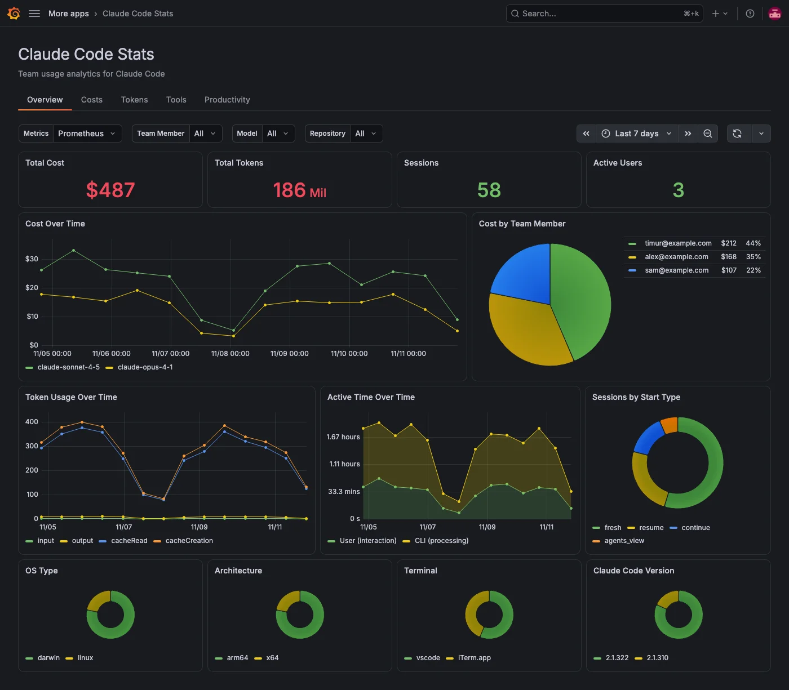

# Claude Code Stats

A Grafana app for team usage analytics on Claude Code. It reads the OpenTelemetry metrics, events and traces that Claude Code exports and shows cost, tokens, tools, productivity, prompts, workflow, reliability, security and traces, without building dashboards yourself.



## Documentation

The user docs live in [`catalog-docs/`](catalog-docs/index.md) and ship as the **Documentation** tab on the plugin's catalog page:

- [Setup](catalog-docs/index.md): requirements (Grafana 13.2 or later, Prometheus, and Loki and Tempo for the event and trace tabs) and the Claude Code settings to export telemetry
- [Configure](catalog-docs/configure.md): metric format, filter labels, provisioning and alerts
- [Features](catalog-docs/features/index.md): what each tab shows
- [Troubleshooting](catalog-docs/troubleshooting.md)

Example alert rules are in [`examples/alerting/`](examples/alerting/).

## Development

```bash
npm install
npm run dev       # build the frontend and watch for changes
npm run server    # Grafana, Prometheus, Loki, Tempo and an OTel Collector in Docker
```

Grafana runs at http://localhost:3000 with the plugin loaded. Point Claude Code at the collector to send real data:

```bash
export CLAUDE_CODE_ENABLE_TELEMETRY=1
export OTEL_METRICS_EXPORTER=otlp
export OTEL_LOGS_EXPORTER=otlp
export OTEL_EXPORTER_OTLP_PROTOCOL=http/protobuf
export OTEL_EXPORTER_OTLP_ENDPOINT=http://localhost:4318
```

Tests and docs:

```bash
npm run test:ci        # unit tests
npm run e2e            # Playwright against the running Grafana, with mocked data sources
npm run docs:serve     # preview catalog-docs at http://localhost:3001
npm run docs:validate  # check the docs before a release
```

## License

Apache 2.0
