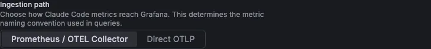

This document explains how to configure Claude Code Stats after you enable it, and how to set up the recommended alert rule.

## Before you begin

Before you configure the app, ensure you have:

- **Grafana permissions:** The `Organization administrator` role. Only organization administrators can configure apps.
- **The app enabled:** Follow [Enable the app](./index.md#enable-the-app).

## Open the configuration page

<!-- snippet:open-app-config -->

To open the Claude Code Stats configuration page:

1. Click **Administration** > **Plugins and data** > **Plugins** in the left-side menu.
1. Enter `Claude Code Stats` in the search bar.
1. Select **Claude Code Stats**.

<!-- /snippet:open-app-config -->

Then click the **Configuration** tab.

## Configure settings

The configuration page has two settings, the metric format and the filter labels, plus a status section and two help tabs. The **Metric Format** and **Filters** sections and the tabs appear only while the app is enabled.

### Plugin status

The **Plugin Status** section shows whether the app is enabled:

| Button             | Description                                                                                                      |
| ------------------ | ---------------------------------------------------------------------------------------------------------------- |
| **Enable Plugin**  | Shown while the app is disabled. Enables the app, pins it to the navigation and saves the current metric format. |
| **Disable Plugin** | Shown while the app is enabled. Disables the app and unpins it.                                                  |

Both buttons save immediately and reload the page.

### Metric format

The **Metric Format** section sets how the app names metrics in its queries. Pick the option that matches how Claude Code metrics reach your data source:



| Setting            | Description                                                                                                                                                                                                                                                                                                                                      | Required |
| ------------------ | ------------------------------------------------------------------------------------------------------------------------------------------------------------------------------------------------------------------------------------------------------------------------------------------------------------------------------------------------ | -------- |
| **Ingestion path** | **Prometheus / OTEL Collector** (default): metrics pass through an OpenTelemetry Collector into Prometheus, which adds `_total` and unit suffixes, such as `claude_code_cost_usage_USD_total`. **Direct OTLP**: metrics go straight to the Grafana Cloud or Mimir OTLP endpoint and keep their original names, such as `claude_code_cost_usage`. | Yes      |

Picking an option saves the setting and reloads the page. If the format doesn't match your ingestion path, every panel shows no data.

### Filters

The **Filters** section adds a filter above the panels for each label you list, so you can slice every tab by a team, cost center or any other attribute your team members send:

| Setting           | Description                                                                                                                                                                                                                                                                              | Required |
| ----------------- | ---------------------------------------------------------------------------------------------------------------------------------------------------------------------------------------------------------------------------------------------------------------------------------------- | -------- |
| **Filter labels** | Attribute names, such as `team.id`, or the Prometheus labels they become, such as `team_id`. Type a name and press Enter. Labels the app already filters by, such as `model` and `user_email`, and names with other characters than letters, digits, dots and underscores can't be used. | No       |

Click **Save filters** to save the list and reload the page. Each filter's picker is named after the label as you entered it, applies to every panel and defaults to **All**. Repository and team filters are built in and don't need to be listed. For how team members set attributes, refer to [Filter by your own attributes](./index.md#filter-by-your-own-attributes).

### Setup Guide

The **Setup Guide** tab builds the Claude Code environment variables to add to each team member's shell profile. It has five steps:

1. **Choose a Destination:** **Grafana Cloud** sends telemetry straight to the Grafana Cloud OTLP endpoint. **OpenTelemetry Collector** sends it to your own Collector. The tab starts on the destination that matches **Ingestion path**. If you pick the other one, it shows **Switch ingestion path**, which saves the matching ingestion path and reloads the page.
1. **Enter the endpoint:** For Grafana Cloud, enter the settings below. For a Collector, enter its OTLP HTTP endpoint, such as `http://<collector-host>:4318`.
1. **Choose Features:** Metrics are always included. Tick the other features you want:

   | Feature            | Adds                                                                                  | Default |
   | ------------------ | ------------------------------------------------------------------------------------- | ------- |
   | **Events**         | `OTEL_LOGS_EXPORTER=otlp`, for the event tabs. Needs Loki.                            | On      |
   | **Traces (beta)**  | `CLAUDE_CODE_ENHANCED_TELEMETRY_BETA=1` and `OTEL_TRACES_EXPORTER=otlp`. Needs Tempo. | Off     |
   | **Repository**     | `OTEL_METRICS_INCLUDE_REPOSITORY=true`, for the **Repository** filter and panels.     | On      |
   | **Surface**        | `OTEL_METRICS_INCLUDE_ENTRYPOINT=true`, for **Surface** on **Overview**.              | On      |
   | **Tool names**     | `OTEL_LOG_TOOL_DETAILS=1`, for real subagent, skill, plugin and MCP server names.     | Off     |
   | **Readable names** | `enduser.id=<name>` in `OTEL_RESOURCE_ATTRIBUTES`, to fill in per team member.        | Off     |

   When you've saved **Filter labels**, the script also sets each of them in `OTEL_RESOURCE_ATTRIBUTES`, with a placeholder value to fill in. For what each feature needs, refer to [Optional telemetry settings](./index.md#optional-telemetry-settings).

1. **Add to Shell Profile:** The script follows your choices. Click **Copy Script** to copy it.
1. **Restart Claude Code.**

For Grafana Cloud, step 2 has these settings:

| Setting                | Description                                                                                                                                                                            | Required |
| ---------------------- | -------------------------------------------------------------------------------------------------------------------------------------------------------------------------------------- | -------- |
| **OTLP Endpoint**      | Your Grafana Cloud OTLP endpoint, such as `https://otlp-gateway-prod-us-east-0.grafana.net/otlp`.                                                                                      | No       |
| **API Token (Base64)** | The Base64 encoding of `<instance-id>:<token>`: the value after `Basic` in the `OTEL_EXPORTER_OTLP_HEADERS` the Grafana Cloud portal generates. The token alone fails to authenticate. | No       |

The fields and feature choices only fill in the script. The app doesn't save them.

### Troubleshooting

The **Troubleshooting** tab lists checks for missing data, empty event and trace tabs, authentication errors and missing data sources, and the metric names for each ingestion path. The same checks are in [Troubleshooting](./troubleshooting.md).

## Provision the app

You can provision Claude Code Stats as code with a Grafana provisioning file. For more information, refer to [Provision Grafana](https://grafana.com/docs/grafana/latest/administration/provisioning/#plugins).

```yaml
apiVersion: 1

apps:
  - type: timurdigital-claudestats-app
    org_id: 1
    disabled: false
    jsonData:
      metricFormat: otlp
      customLabels:
        - team.id
```

| Key                     | What it sets                                                                                                                                              |
| ----------------------- | --------------------------------------------------------------------------------------------------------------------------------------------------------- |
| `org_id`                | The organization to enable the app in.                                                                                                                    |
| `disabled`              | Set to `false` to enable the app.                                                                                                                         |
| `jsonData.metricFormat` | The **Ingestion path**: `prometheus` for **Prometheus / OTEL Collector** or `otlp` for **Direct OTLP**. When you leave it out, the app uses `prometheus`. |
| `jsonData.customLabels` | The **Filter labels**, as a list.                                                                                                                         |

The app has no secure settings, so it doesn't use `secureJsonData`.

## Set up alerts

The plugin repository includes recommended alert rules as Grafana provisioning files. Both add their rules to a **Claude Code** folder.

[`examples/alerting/claude-code-alerts.yaml`](https://github.com/tolzhabayev/claudestats-app-grafana/blob/main/examples/alerting/claude-code-alerts.yaml) reads the metrics:

| Alert rule                            | Fires when                                                                                                                                                       |
| ------------------------------------- | ---------------------------------------------------------------------------------------------------------------------------------------------------------------- |
| **Claude Code cost spike per member** | A team member's estimated spend in the last hour is over $5 and more than 3 times their average hourly spend over the last 7 days. It's checked every 5 minutes. |

[`examples/alerting/claude-code-event-alerts.yaml`](https://github.com/tolzhabayev/claudestats-app-grafana/blob/main/examples/alerting/claude-code-event-alerts.yaml) reads the events in Loki, so it needs `OTEL_LOGS_EXPORTER=otlp`, as described in [Send events to Loki](./index.md#send-events-to-loki):

| Alert rule                                    | Fires when                                                                                                                                                                   |
| --------------------------------------------- | ---------------------------------------------------------------------------------------------------------------------------------------------------------------------------- |
| **Claude Code API error rate spike**          | More than 10% of API requests failed in the last 15 minutes, with at least 5 errors, for 5 minutes in a row.                                                                 |
| **Claude Code refusal spike**                 | The model refused more than 5 requests in the last hour. Refusals the API already retried on another model don't count.                                                      |
| **Claude Code switched to bypassPermissions** | A team member switched to `bypassPermissions` mode, which allows every tool call without a check. It looks back 10 minutes, so a switch that reaches Loki late isn't missed. |

The rules are checked every 5 minutes. Team members are identified the same way as in the app: by email address, else `enduser.id`, else the anonymous Claude Code user ID.

To add the rules:

1. Copy the files you want into the `provisioning/alerting` directory of your Grafana server.
1. Set `datasourceUid` to the UID of the data source with your Claude Code data: Prometheus for `claude-code-alerts.yaml`, Loki for `claude-code-event-alerts.yaml`. The UID is the last part of the URL when you open the data source under **Connections** > **Data sources**.
1. If **Ingestion path** is **Direct OTLP**, replace `claude_code_cost_usage_USD_total` with `claude_code_cost_usage` in the cost spike query.
1. Change the thresholds in the queries if they don't fit your team.
1. Restart Grafana.

Alerts go to your default contact point. For more information, refer to [Provision alert rules](https://grafana.com/docs/grafana/latest/alerting/set-up/provision-alerting-resources/file-provisioning/).
