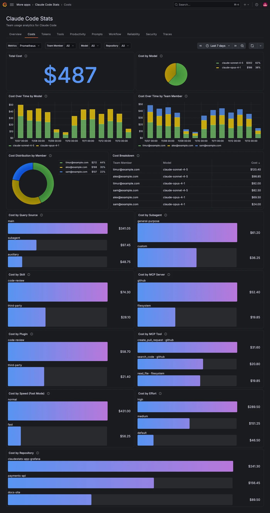

The **Costs** tab breaks down the estimated cost Claude Code reports after each API request. Use it to find which models, team members and features drive spend.

## See spend by model and team member

| Panel                             | What it shows                                                  |
| --------------------------------- | -------------------------------------------------------------- |
| **Total Cost**                    | Estimated cost in US dollars for the period.                   |
| **Cost by Model**                 | Each model's share of cost.                                    |
| **Cost Over Time by Model**       | Cost per interval, one series per model.                       |
| **Cost Over Time by Team Member** | Cost per interval, one series per member.                      |
| **Cost Distribution by Member**   | Each member's share of cost.                                   |
| **Cost Breakdown**                | A table with one row per model and team member and their cost. |

## Find what drives spend

The bar gauges attribute cost to what issued each request, largest first:

| Panel                         | What it shows                                                  |
| ----------------------------- | -------------------------------------------------------------- |
| **Cost by Query Source**      | `main` conversation, `subagent` or `auxiliary` requests.       |
| **Cost by Subagent**          | Which subagent type issued the request.                        |
| **Cost by Skill**             | Which skill was active.                                        |
| **Cost by MCP Server**        | Which MCP server's tool result the request used.               |
| **Cost by Plugin**            | Which plugin owns the active skill or subagent.                |
| **Cost by MCP Tool**          | Which MCP tool's result the request used, as `server / tool`.  |
| **Cost by Repository**        | Which Git repository Claude Code was working in.               |
| **Cost by Speed (Fast Mode)** | `fast` for fast mode, `normal` otherwise.                      |
| **Cost by Effort**            | The effort level, or `default` when the model doesn't use one. |

**Cost by Subagent**, **Cost by Skill**, **Cost by MCP Server**, **Cost by Plugin** and **Cost by MCP Tool** show no data when no request in the period used one. User-defined subagents, third-party skills and plugins, and user-configured MCP servers and their tools show as `custom` or `third-party` unless team members set `OTEL_LOG_TOOL_DETAILS=1`. **Cost by Repository** needs `OTEL_METRICS_INCLUDE_REPOSITORY=true`. For details, refer to [Optional telemetry settings](../index.md#optional-telemetry-settings).

## Filters on this tab

**Team Member** and **Model** apply to every panel, except that **Cost by Model** ignores **Model** and **Cost Distribution by Member** ignores **Team Member**, so you can compare. **Repository** and any [filter labels](../configure.md#filters) apply to every panel.
