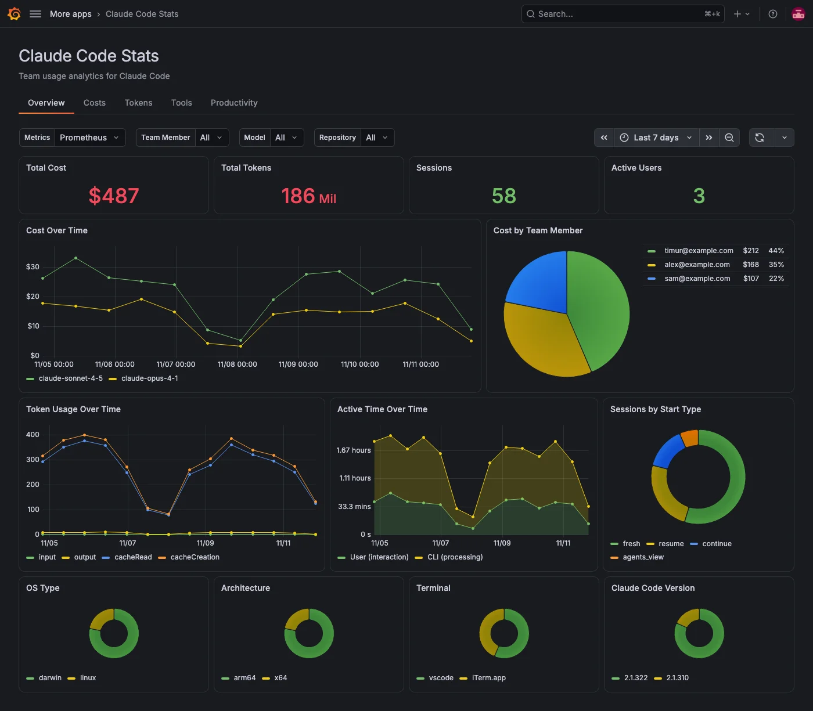

The **Overview** tab is the landing page of Claude Code Stats. It summarizes your team's Claude Code usage for the selected time range and filters.

## Check usage at a glance

The top row shows four totals:

| Panel            | What it shows                                                                                                                                                                                                 |
| ---------------- | ------------------------------------------------------------------------------------------------------------------------------------------------------------------------------------------------------------- |
| **Total Cost**   | Estimated cost in US dollars.                                                                                                                                                                                 |
| **Total Tokens** | All tokens: input, output, cache reads and cache writes.                                                                                                                                                      |
| **Sessions**     | Distinct Claude Code sessions started. Launches of the `claude agents` dashboard don't count.                                                                                                                 |
| **Active Users** | Team members whose Claude Code reported cost data in the period. This includes members with an open but idle session, because Claude Code keeps reporting its cost counter. Unattributed usage isn't counted. |

Cost is the estimate Claude Code reports. For billing data, use your Anthropic or cloud provider console.

The row under the totals compares cost, tokens, sessions and active users with the previous period of the same length, such as the 7 days before the last 7 days. Each shows **No previous period** when the previous period had none to compare with, and -100% when it had some but this period has none.

## Check efficiency

The second row shows three ratios for the period:

| Panel                    | What it shows                                                                                                                                             |
| ------------------------ | --------------------------------------------------------------------------------------------------------------------------------------------------------- |
| **Cache Hit Rate**       | The share of prompt tokens read from the prompt cache: cache reads divided by input, cache reads and cache writes. Cache reads cost much less than input. |
| **Cost per Session**     | Estimated cost divided by **Sessions**.                                                                                                                   |
| **Cost per Active Hour** | Estimated cost divided by active time, in hours.                                                                                                          |

## Compare team members

**Team Leaderboard** has one row per team member with their cost, tokens, sessions, active time, lines added and removed, commits, pull requests and edit acceptance rate. It's sorted by cost. Click a column header to sort by it, or click a member's name to filter every tab to that member, keeping your other filters. Usage that can't be attributed to anyone isn't listed, but still counts in the totals and the other per-member panels.

## See trends over time

| Panel                      | What it shows                                                                                                             |
| -------------------------- | ------------------------------------------------------------------------------------------------------------------------- |
| **Cost Over Time**         | Cost per interval, one series per model.                                                                                  |
| **Cost by Team Member**    | Each member's share of cost.                                                                                              |
| **Token Usage Over Time**  | Tokens per interval, stacked by token type.                                                                               |
| **Active Time Over Time**  | Active time per interval, stacked as User (interaction, such as typing) and CLI (running tools and generating responses). |
| **Sessions by Start Type** | Sessions by how they started: `fresh`, `resume`, `continue` or `agents_view`.                                             |

## Check your team's environment

The bottom row shows how usage splits across environments, weighted by cost: **OS Type**, **Architecture**, **Terminal** and **Claude Code Version**.

## Filters on this tab

**Team Member** applies to every panel except **Cost by Team Member** and **Team Leaderboard**. **Model** applies to the cost and token panels only: **Total Cost**, **Total Tokens**, **Cache Hit Rate**, **Cost per Session**, **Cost per Active Hour**, **Cost Over Time**, **Cost by Team Member**, **Token Usage Over Time** and the cost and tokens columns of **Team Leaderboard**. Active time isn't recorded per model, so with a model selected **Cost per Active Hour** divides that model's cost by all active time. **Repository** and any [filter labels](../configure.md#filters) apply to every panel.
