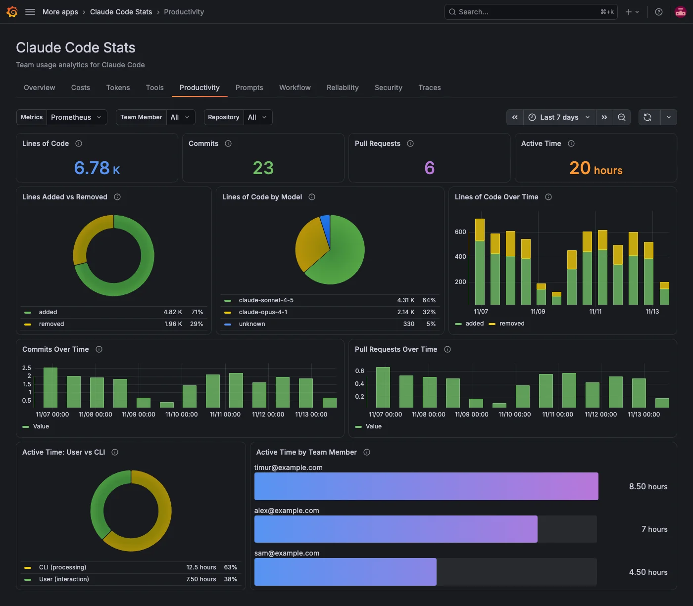

The **Productivity** tab shows the output of your team's Claude Code sessions and how much time they spend in them.

## Track output

| Panel                       | What it shows                                                 |
| --------------------------- | ------------------------------------------------------------- |
| **Lines of Code**           | Lines Claude Code added plus lines it removed.                |
| **Commits**                 | Git commits Claude Code created.                              |
| **Pull Requests**           | Pull requests or merge requests Claude Code created.          |
| **Lines Added vs Removed**  | The split between added and removed lines.                    |
| **Lines of Code by Model**  | Lines added plus removed, split by the model that wrote them. |
| **Lines of Code Over Time** | Added and removed lines per interval.                         |
| **Commits Over Time**       | Commits per interval.                                         |
| **Pull Requests Over Time** | Pull requests per interval.                                   |

Panels show no data when nothing happened in the period, such as no commits.

Claude Code records the model for lines of code from version 2.1.172. Lines from older versions show as `unknown` in **Lines of Code by Model**.

## Track active time

Claude Code records active time in two parts: **User** is time spent interacting, such as typing, and **CLI** is time Claude Code spends running tools and generating responses.

| Panel                          | What it shows                                                                                     |
| ------------------------------ | ------------------------------------------------------------------------------------------------- |
| **Active Time**                | Time spent actively using Claude Code, not counting idle time. It's the sum of User and CLI time. |
| **Active Time: User vs CLI**   | The split between User (interaction) and CLI (processing) time, with each part's share.           |
| **Active Time by Team Member** | Active time per member.                                                                           |

## Filters on this tab

**Team Member** applies to every panel except **Active Time by Team Member**, which always shows every member. The tab has no **Model** filter, because commits, pull requests and active time aren't recorded per model. **Lines of Code by Model** always shows every model. **Repository** and any [filter labels](../configure.md#filters) apply to every panel.
