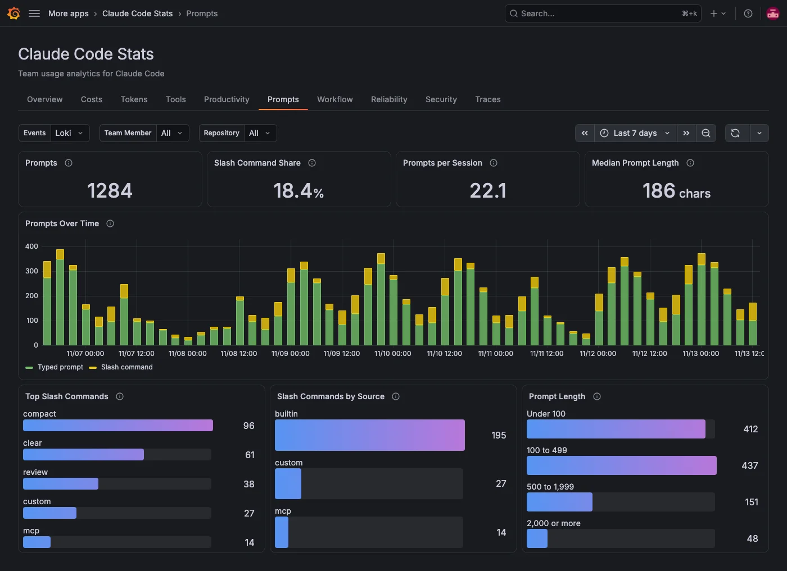

The **Prompts** tab shows how your team prompts Claude Code: how much, with which slash commands and how long the prompts are. It reads the `user_prompt` events Claude Code sends as OpenTelemetry logs, so it needs a Loki data source and an extra Claude Code setting. For details, refer to [Send events to Loki](../index.md#send-events-to-loki).

The tab uses only counts, lengths and command names. The prompt text stays redacted unless team members set `OTEL_LOG_USER_PROMPTS=1`, and the tab doesn't need it.

## Check prompting at a glance

| Panel                    | What it shows                                                                          |
| ------------------------ | -------------------------------------------------------------------------------------- |
| **Prompts**              | Prompts sent in the period, typed prompts and slash commands together.                 |
| **Slash Command Share**  | The share of prompts that invoked a slash command, such as `/compact`.                 |
| **Prompts per Session**  | The average number of prompts in a session that had at least one prompt in the period. |
| **Median Prompt Length** | The median length of typed prompts, in characters. Slash commands aren't counted.      |

## See what your team asks for

| Panel                        | What it shows                                                                                  |
| ---------------------------- | ---------------------------------------------------------------------------------------------- |
| **Prompts Over Time**        | Prompts per interval, stacked as typed prompts and slash commands.                             |
| **Top Slash Commands**       | The most-used slash commands.                                                                  |
| **Slash Commands by Source** | Where the commands come from: `builtin`, `custom` or `mcp`. Plugin commands count as `custom`. |
| **Prompt Length**            | Typed prompts by length: under 100, 100 to 499, 500 to 1,999, and 2,000 or more characters.    |

Built-in commands, such as `compact`, show their name. Custom, plugin and MCP commands show as `custom` or `mcp` unless team members set `OTEL_LOG_TOOL_DETAILS=1`.

## Filters on this tab

**Events** picks the Loki data source with Claude Code events. **Team Member**, **Repository** and any [filter labels](../configure.md#filters) apply to every panel. The tab has no **Model** filter, because prompts aren't recorded per model.
