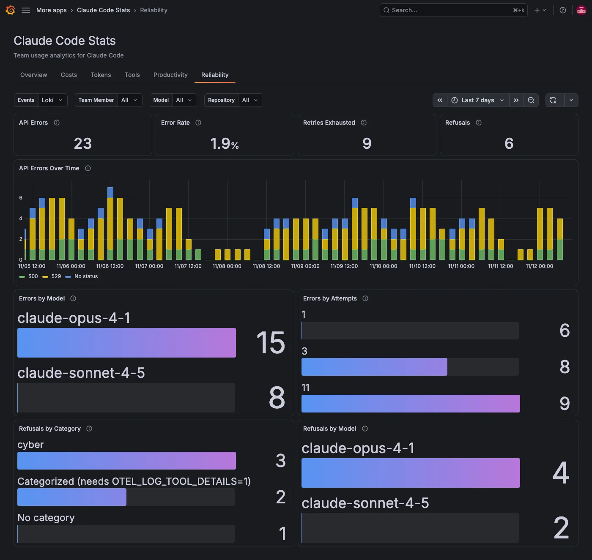

The **Reliability** tab shows how often Claude Code's API requests fail or are refused. It reads the events Claude Code sends as OpenTelemetry logs, not the metrics the other tabs use, so it needs a Loki data source and an extra Claude Code setting. For details, refer to [Send events to Loki](../index.md#send-events-to-loki).

## Check errors and refusals at a glance

| Panel                 | What it shows                                                                                                                                                                                              |
| --------------------- | ---------------------------------------------------------------------------------------------------------------------------------------------------------------------------------------------------------- |
| **API Errors**        | API requests that failed after Claude Code gave up retrying. Claude Code retries a failed request itself and reports one error at the end.                                                                 |
| **Error Rate**        | API errors as a share of all API requests, failed and successful.                                                                                                                                          |
| **Retries Exhausted** | Requests that still failed after more than one attempt.                                                                                                                                                    |
| **Refusals**          | Responses the model refused. Refusals aren't API errors, so this is the only place they show up. Refusals the API already retried on another model aren't counted, because the team member never saw them. |

When Loki has no Claude Code events for the period, these panels say so instead of showing 0.

## Find what fails

| Panel                    | What it shows                                                                                                                     |
| ------------------------ | --------------------------------------------------------------------------------------------------------------------------------- |
| **API Errors Over Time** | Errors per interval, stacked by HTTP status code. Timeouts and connection failures have no status code and show as **No status**. |
| **Errors by Model**      | Errors per model.                                                                                                                 |
| **Errors by Attempts**   | Errors by how many attempts Claude Code made, including the first request. By default Claude Code gives up after 11.              |
| **Refusals by Category** | Refusals by category: `cyber`, `bio`, `frontier_llm` or `reasoning_extraction`.                                                   |
| **Refusals by Model**    | Refusals per model.                                                                                                               |

Claude Code sends the refusal category only when team members set `OTEL_LOG_TOOL_DETAILS=1`. Without it, a refusal that has a category shows as **Categorized (needs OTEL_LOG_TOOL_DETAILS=1)**, and one without a category shows as **No category**.

## Filters on this tab

**Events** picks the Loki data source with Claude Code events. **Team Member**, **Model**, **Repository** and any [filter labels](../configure.md#filters) apply to every panel.

The filters are shared with the other tabs, so their options come from the Claude Code metrics, not from the events. When team members send both, which is the usual setup, the options match. If Claude Code sends only events, the pickers offer only **All**.
