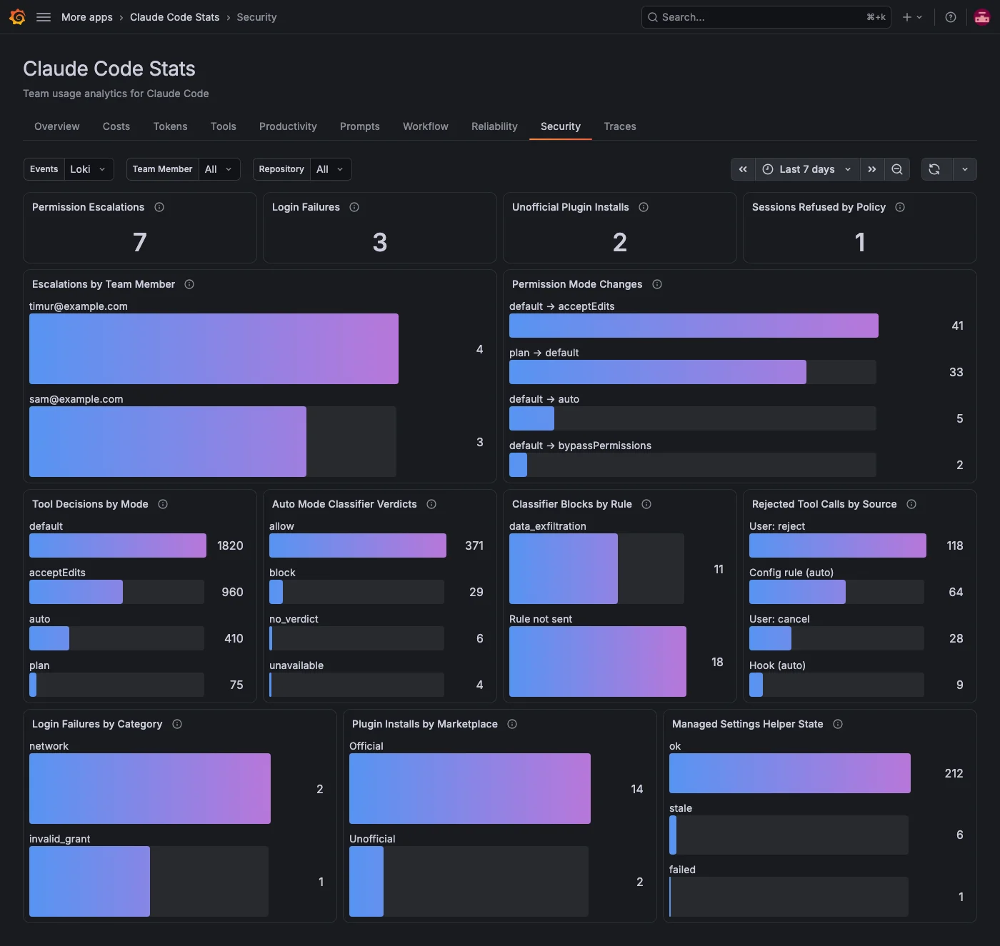

The **Security** tab is for administrators who audit how Claude Code runs across the team: who loosened permission checks, what auto mode allowed or blocked, which tool calls were rejected, failed logins, plugins from unofficial marketplaces and whether machines run the expected managed settings. It reads the events Claude Code sends as OpenTelemetry logs, so it needs a Loki data source and an extra Claude Code setting. For details, refer to [Send events to Loki](../index.md#send-events-to-loki).

The tab works without `OTEL_LOG_TOOL_DETAILS`. The panels that need it for names say so.

## Check at a glance

| Panel                          | What it shows                                                                                           |
| ------------------------------ | ------------------------------------------------------------------------------------------------------- |
| **Permission Escalations**     | Switches to `bypassPermissions` (every tool call allowed) or `auto` (a classifier decides) mode.        |
| **Login Failures**             | Failed logins to Claude Code.                                                                           |
| **Unofficial Plugin Installs** | Plugins installed from a marketplace that isn't an official Anthropic one.                              |
| **Sessions Refused by Policy** | Sessions a managed settings policy stopped from starting, for example because the policy helper failed. |

## See who changed permission modes

| Panel                          | What it shows                                                    |
| ------------------------------ | ---------------------------------------------------------------- |
| **Escalations by Team Member** | Who switched to `bypassPermissions` or `auto` mode.              |
| **Permission Mode Changes**    | Every permission mode change, shown as previous mode → new mode. |

## Review tool call checks

| Panel                             | What it shows                                                                                                                                                                             |
| --------------------------------- | ----------------------------------------------------------------------------------------------------------------------------------------------------------------------------------------- |
| **Tool Decisions by Mode**        | Permission checks by the mode they ran in. Needs Claude Code v2.1.301 or later.                                                                                                           |
| **Auto Mode Classifier Verdicts** | What the auto mode classifier decided: `allow`, `block`, `no_verdict` (no usable answer, so the call was denied) or `unavailable` (the check failed, so the call was denied).             |
| **Classifier Blocks by Rule**     | Blocked calls by the built-in rule the classifier named, such as `data_exfiltration`. The rule is sent only with `OTEL_LOG_TOOL_DETAILS=1`; without it, blocks show as **Rule not sent**. |
| **Rejected Tool Calls by Source** | Rejected calls by who rejected them. **Config rule (auto)** covers settings rules, managed policy, the permission mode and the classifier.                                                |

## Check logins, plugins and managed settings

| Panel                              | What it shows                                                                                                                      |
| ---------------------------------- | ---------------------------------------------------------------------------------------------------------------------------------- |
| **Login Failures by Category**     | Failed logins and logouts by error category. The error message itself is never sent.                                               |
| **Plugin Installs by Marketplace** | Plugin installs from official Anthropic marketplaces and from others. Names of third-party plugins need `OTEL_LOG_TOOL_DETAILS=1`. |
| **Managed Settings Helper State**  | The state of the managed settings policy helper, reported when a session starts and when it changes.                               |

MCP server connections and failures are on the [Workflow](./workflow.md) tab. To get alerted on events like these, refer to [Set up alerts](../configure.md#set-up-alerts).

## Filters on this tab

**Events** picks the Loki data source with Claude Code events. **Team Member**, **Repository** and any [filter labels](../configure.md#filters) apply to every panel. The tab has no **Model** filter, because these events aren't recorded per model.
