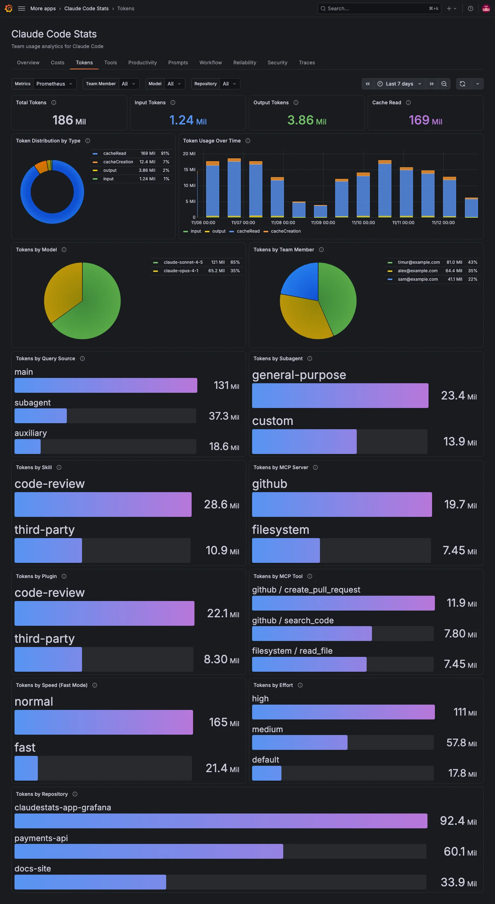

The **Tokens** tab shows how many tokens your team's Claude Code requests use and where they go.

## See token volume

| Panel                          | What it shows                                                               |
| ------------------------------ | --------------------------------------------------------------------------- |
| **Total Tokens**               | All tokens for the period.                                                  |
| **Input Tokens**               | Input tokens, not counting tokens read from or written to the prompt cache. |
| **Output Tokens**              | Tokens the model generated.                                                 |
| **Cache Read**                 | Tokens read from the prompt cache.                                          |
| **Token Distribution by Type** | Each type's share: `input`, `output`, `cacheRead` and `cacheCreation`.      |
| **Token Usage Over Time**      | Token rate per second, one series per type.                                 |
| **Tokens by Model**            | Each model's share of tokens.                                               |
| **Tokens by Team Member**      | Each member's share of tokens.                                              |

A high share of `cacheRead` is normal. Claude Code reuses the prompt cache across turns, and cache reads cost much less than input tokens.

## Find what drives token usage

The bar gauges attribute tokens the same way the [Costs](./costs.md#find-what-drives-spend) tab attributes cost: **Tokens by Query Source**, **Tokens by Subagent**, **Tokens by Skill**, **Tokens by MCP Server**, **Tokens by Plugin**, **Tokens by MCP Tool**, **Tokens by Speed (Fast Mode)** and **Tokens by Effort**.

## Filters on this tab

**Team Member** and **Model** apply to every panel, except that **Tokens by Model** ignores **Model** and **Tokens by Team Member** ignores **Team Member**, so you can compare.
