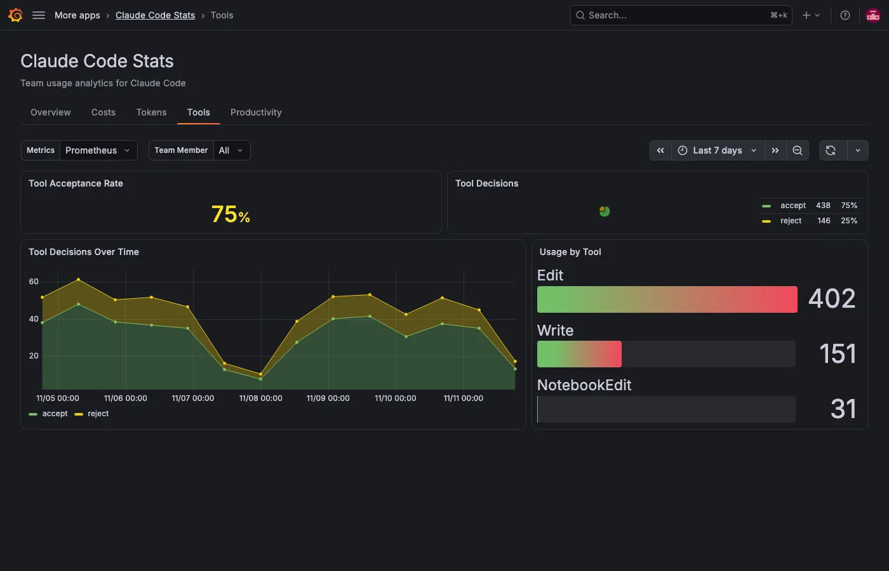

The **Tools** tab shows the permission decisions team members make on the file-editing tools: `Edit`, `Write` and `NotebookEdit`. Its last section shows how every tool, such as Bash or an MCP tool, performs when it runs, from the events Claude Code sends to Loki.

## Check the acceptance rate

| Panel                        | What it shows                                       |
| ---------------------------- | --------------------------------------------------- |
| **Tool Acceptance Rate**     | The percentage of edit decisions that were accepts. |
| **Tool Decisions**           | Accepts and rejects for the period.                 |
| **Tool Decisions Over Time** | Accepts and rejects per interval.                   |
| **Usage by Tool**            | Decisions per tool.                                 |

A decision counts whether a team member made it or a configuration rule or hook made it automatically.

## Break down decisions by language and source

| Panel                           | What it shows                                                                                            |
| ------------------------------- | -------------------------------------------------------------------------------------------------------- |
| **Acceptance Rate by Language** | The acceptance rate for each language of the edited file, such as TypeScript or Markdown, highest first. |
| **Decisions by Source**         | Who made each decision, with the count and share of each.                                                |

**Decisions by Source** shows these sources:

| Source                 | Meaning                                                              |
| ---------------------- | -------------------------------------------------------------------- |
| **Config rule (auto)** | A permission rule in the Claude Code settings decided automatically. |
| **Hook (auto)**        | A hook made the decision.                                            |
| **User: always allow** | The team member allowed the edit and similar edits from then on.     |
| **User: allow once**   | The team member allowed this edit only.                              |
| **User: reject**       | The team member rejected the edit.                                   |
| **User: cancel**       | The team member cancelled the prompt without answering.              |

A language with only a few decisions can swing between 0% and 100%, so compare it with **Decisions by Source** and **Usage by Tool** before drawing conclusions.

## Check tool performance

These panels read `tool_result` events from Loki, so they need `OTEL_LOGS_EXPORTER=otlp` and a Loki data source, picked in **Events**. For details, refer to [Send events to Loki](../index.md#send-events-to-loki). They cover every tool that ran. Rejected calls never run, so they don't appear here.

| Panel                                     | What it shows                                                                                                                                             |
| ----------------------------------------- | --------------------------------------------------------------------------------------------------------------------------------------------------------- |
| **Tool Performance**                      | One row per tool with its number of calls, the share that failed, and its median (**p50**) and 95th percentile (**p95**) execution time. Sorted by calls. |
| **Failures by Error Type**                | Failed calls by error category, such as `ShellError` or `Error:ENOENT`.                                                                                   |
| **p95 Execution Time by Decision Source** | The 95th percentile execution time by who allowed the call, with the source names from **Decisions by Source**.                                           |

## Filters on this tab

**Team Member** applies to every panel. The tab has no **Model** filter, because edit decisions and tool results aren't recorded per model. **Events** picks the Loki data source for the tool performance panels. **Repository** and any [filter labels](../configure.md#filters) apply to every panel.
