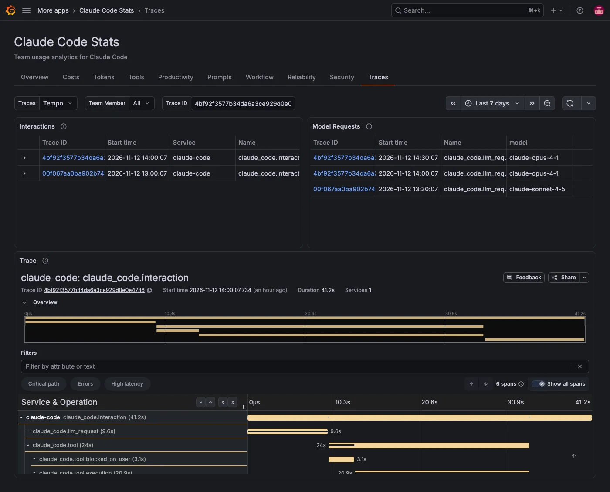

The **Traces** tab shows what one prompt did, end to end: each model request with its time to first token, and each tool call with the time spent waiting for permission and running the tool. It reads the traces Claude Code sends, so it needs a Tempo data source and the Claude Code tracing settings. For details, refer to [Send traces to Tempo](../index.md#send-traces-to-tempo).

Tracing is a beta feature of Claude Code, so the span names and attributes can still change.

## Find a prompt

| Panel              | What it shows                                                                                                                 |
| ------------------ | ----------------------------------------------------------------------------------------------------------------------------- |
| **Interactions**   | One row per prompt (a `claude_code.interaction` trace), newest first, with its start time and duration.                       |
| **Model Requests** | Model requests (`claude_code.llm_request` spans) with their model, time to first token (`ttft_ms`), duration and stop reason. |

Click a trace ID and choose **Show this trace**, or enter a trace ID in **Trace ID**, to show that trace below. Your other filters stay as they are.

## Read the waterfall

**Trace** shows the picked trace as a waterfall. Until you pick one, it asks you to and doesn't query Tempo. The prompt is the top span. Under it are its model requests and tool calls. Each tool call has two parts: the time spent waiting for a permission decision and the time spent running the tool. Subagent requests and tool calls nest under the tool call that started the subagent.

Prompt text, tool input and tool output stay redacted unless team members set `OTEL_LOG_USER_PROMPTS=1`, `OTEL_LOG_TOOL_DETAILS=1` or `OTEL_LOG_TOOL_CONTENT=1`.

## Filters on this tab

**Traces** picks the Tempo data source with Claude Code traces. **Team Member** applies to both lists. **Trace ID** picks the trace for the waterfall. The tab has no **Model**, **Repository** or **Team** filter.
