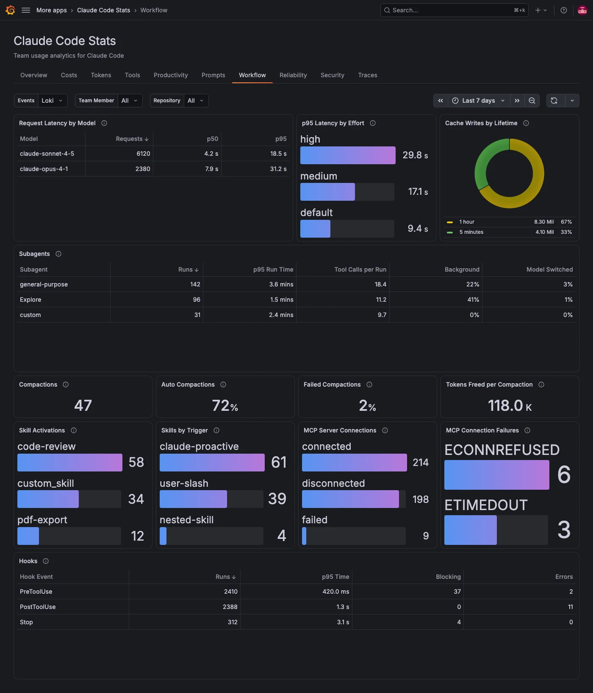

The **Workflow** tab shows how Claude Code works behind the scenes: how fast models answer, what subagents do, how often the context is compacted, which skills run, whether MCP servers connect and how long hooks take. It reads the events Claude Code sends as OpenTelemetry logs, so it needs a Loki data source and an extra Claude Code setting. For details, refer to [Send events to Loki](../index.md#send-events-to-loki).

## Check model latency

| Panel                        | What it shows                                                                                                    |
| ---------------------------- | ---------------------------------------------------------------------------------------------------------------- |
| **Request Latency by Model** | API requests per model with their median (**p50**) and 95th percentile (**p95**) duration.                       |
| **p95 Latency by Effort**    | The 95th percentile request duration by effort level. Requests sent without an effort level show as `default`.   |
| **Cache Writes by Lifetime** | Prompt cache write tokens by how long the entry lives: 5 minutes or 1 hour. Needs Claude Code v2.1.300 or later. |

## See what subagents do

**Subagents** has one row per subagent type with its runs, 95th percentile run time, average tool calls per run, the share that ran in the background, and the share that more than one model served after a fallback. User-defined agents show as `custom` unless team members set `OTEL_LOG_TOOL_DETAILS=1`.

## Track context compaction

| Panel                           | What it shows                                                                                                                        |
| ------------------------------- | ------------------------------------------------------------------------------------------------------------------------------------ |
| **Compactions**                 | Compactions that completed in the period.                                                                                            |
| **Auto Compactions**            | The share Claude Code triggered on its own when the context filled up, rather than `/compact`. A high share points to long sessions. |
| **Failed Compactions**          | The share of compactions that failed.                                                                                                |
| **Tokens Freed per Compaction** | The average number of context tokens a compaction freed.                                                                             |

## Check skills and MCP servers

| Panel                       | What it shows                                                                                                                               |
| --------------------------- | ------------------------------------------------------------------------------------------------------------------------------------------- |
| **Skill Activations**       | Activations per skill. User-defined and third-party plugin skills show as `custom_skill` unless team members set `OTEL_LOG_TOOL_DETAILS=1`. |
| **Skills by Trigger**       | How skills started: `user-slash` (a person ran it), `claude-proactive` (Claude picked it up on its own) or `nested-skill`.                  |
| **MCP Server Connections**  | Connection events by status: `connected`, `failed` or `disconnected`.                                                                       |
| **MCP Connection Failures** | Failed connections by error code.                                                                                                           |

## Find slow hooks

**Hooks** has one row per hook event, such as `PreToolUse`: how often its hooks ran, the 95th percentile time spent in them, and how many returned a blocking decision or failed. Time in hooks adds directly to the time a team member waits.

## Filters on this tab

**Events** picks the Loki data source with Claude Code events. **Team Member**, **Repository** and any [filter labels](../configure.md#filters) apply to every panel. The tab has no **Model** filter, because most of these events aren't recorded per model.
